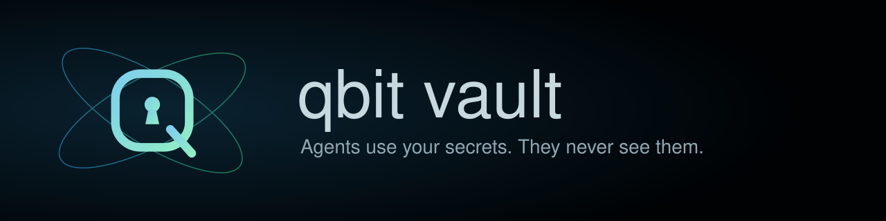
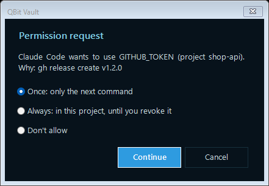
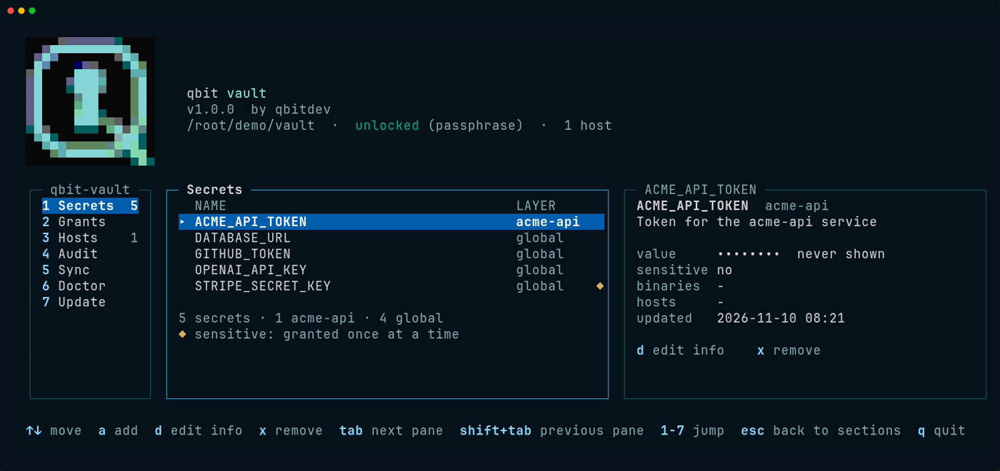
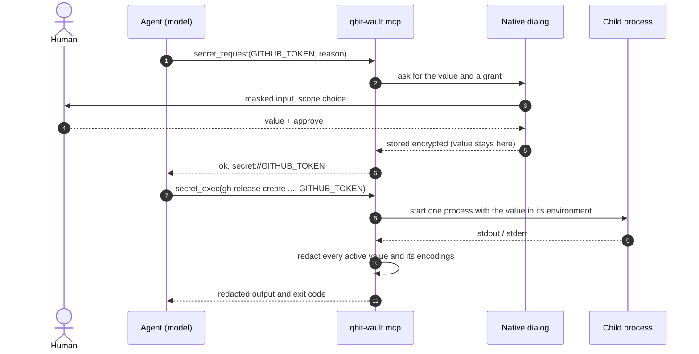

<p align="center">
  
</p>

<h1 align="center">QBit Vault</h1>

<p align="center">
  <strong>Agents use your secrets. They never see them.</strong><br>
  <sub>QBit Vault by <strong>qbitdev</strong></sub>
</p>

<p align="center">
  <a href="https://github.com/qbitdevz/qbit-vault/releases"></a>
  <a href="https://github.com/qbitdevz/qbit-vault/actions/workflows/ci.yml"></a>
  <a href="LICENSE"></a>
  <a href="go.mod"></a>
</p>

<p align="center">
  
</p>

QBit Vault (`qbit-vault`) is a local secrets broker for coding agents. Claude Code, Codex and Pi / Gentle Shell can run commands that need a `GITHUB_TOKEN`, a `DATABASE_URL` or any API key, and the value never enters the model's context, the chat transcript, the session file or the provider's servers.

## Why

- **The value never reaches the model.** The agent asks for a secret by **name**. The value lives in an encrypted vault and, for one command, in the environment of that one child process: not in the chat, not in the transcript, not on the provider's servers.
- **You approve out of band.** A native dialog, outside the chat, asks you to allow each use (once, or always in this project). Only you can grant access: there is no `grant` tool for the agent.
- **Output comes back redacted.** Wherever the value appears in stdout or stderr, in any common encoding, the agent sees `[REDACTED:GITHUB_TOKEN]`.
- **Local first.** The vault is one encrypted file on your machine, with its key in your OS keychain. Syncing several machines through a server you host yourself is optional and zero-knowledge.

## Install

```bash
# Linux, macOS, WSL
curl -fsSL https://github.com/qbitdevz/qbit-vault/releases/latest/download/install.sh | sh
```

```powershell
# Windows (PowerShell)
irm https://github.com/qbitdevz/qbit-vault/releases/latest/download/install.ps1 | iex
```

The scripts are assets of every release (`releases/latest/download/…`); the copies in `scripts/` are the same files. The script downloads the release for your system, checks its SHA-256 and installs `qbit-vault` (Linux and macOS: `~/.local/bin`; Windows: added to your `PATH`, open a new terminal). Running it again upgrades in place. With Go 1.26+ you can use `go install github.com/qbitdevz/qbit-vault/cmd/qbit-vault@latest` instead. Every release also carries a build-provenance attestation you can verify with `gh attestation verify`. Options and details: [docs/INSTALL.md](docs/INSTALL.md).

## First 5 minutes

1. **Install** with the command above.
2. **Run `qbit-vault init`** (or just `qbit-vault`, which opens a guided setup in a terminal). It creates an **empty** vault in `~/.qbit-vault/` and connects the agents it finds. It never reads your `.env` files or environment variables.
3. **Restart your agent** so it loads QBit Vault.
4. **Ask for something that needs a credential** (*"create a GitHub release for v1.2"*). A window like this opens, outside the chat; approve it:

<p align="center">
  
</p>

Pick **Once** (the default) and it asks again next time; pick **Always: in this project** and it stops asking in that repository until you revoke it (`qbit-vault revoke`). The agent never sees the value either way. A secret that does not exist yet is typed right in that dialog.

You can also store secrets yourself, with a hidden prompt (nothing is echoed or kept in your shell history):

```bash
qbit-vault set GITHUB_TOKEN --global       # usable in every folder
cd my-project
qbit-vault set DATABASE_URL --project      # only for this repository
```

What `init` does, step by step, where the master key lives (OS keychain, or a passphrase where there is none, such as WSL or a Linux server: `qbit-vault unlock` opens it) and how to uninstall: [docs/INSTALL.md](docs/INSTALL.md).

## A terminal app too

Run `qbit-vault` in a terminal for the interactive app: a first-run setup, then three panes for your secrets, grants, agent hosts, the audit log, sync status and the doctor report. It shows names and metadata only; values and passphrases are typed in the hidden prompt, never in the app, and it can revoke grants but never create one.

<p align="center">
  
</p>

<p align="center"><a href="assets/demo/tui.gif">Watch a short tour of the TUI (GIF)</a></p>

Reference and keys: [docs/CLI.md § TUI](docs/CLI.md#tui).

## How it works



The model sees tool names, secret **names** and redacted results. The value exists only in the dialog, the encrypted vault and the environment of that one child process.

| Tool | What the model gets back |
| --- | --- |
| `secret_list()` | Names, layers, descriptions, scopes and the rules the agent must follow. Never values. |
| `secret_request(name, reason)` | `ok` and a `secret://NAME` reference, after you approved or typed the value in the dialog. Never the value. |
| `secret_exec(command, secrets)` | Redacted stdout and stderr plus the exit code. |
| `secret_manage(action, name, ...)` | Proposes remove, edit, move or replace. You confirm outside the chat; the agent gets `ok`. |

The wire contract: [contracts/secrets-broker/v1/CONTRACT.md](contracts/secrets-broker/v1/CONTRACT.md). Components and data flows: [docs/ARCHITECTURE.md](docs/ARCHITECTURE.md).

### Global and project secrets

Each secret lives in one of two **layers**: **global** (every folder: a personal `GITHUB_TOKEN`) or **project** (one git repository: its `DATABASE_URL`, a client's deploy token). Inside a repository the project's secret wins; if the project has none, the global one is used. From repository A the agent can never see or use the secrets of repository B, and the permissions you approve are tied to the layer too. `qbit-vault list` shows what this folder sees; `qbit-vault list --layer all` shows everything. Both layers live in the same encrypted vault under `~/.qbit-vault/`, never in the repository.

### Everyday commands

| You want to | Command |
| --- | --- |
| See which secrets exist (names only, never values) | `qbit-vault list` |
| See what was used and who approved it | `qbit-vault audit` |
| Check that everything is set up | `qbit-vault doctor` |
| Take back every permission you gave | `qbit-vault revoke --all` |
| Move a secret between global and this project | `qbit-vault mv NAME --to global` (or `--to project`) |
| Open a passphrase-protected vault | `qbit-vault unlock` |
| Upgrade | `qbit-vault update`, or `u` in the TUI Update section when the header says `update available` (or run the install command again) |
| Uninstall | `qbit-vault uninstall` (keeps the vault) or `qbit-vault uninstall --purge` (deletes it) |

Every command, flag and exit code: [docs/CLI.md](docs/CLI.md). Most commands take `--json`.

## Supported agents

Every agent gets the MCP server and the `qbit-vault` skill; only Claude Code also gets hooks and deny rules. The skill is kept current by `qbit-vault sync`, which the install scripts run after every upgrade.

| Agent | MCP tools | Skill | Hooks | Deny rules | Notes |
| --- | --- | --- | --- | --- | --- |
| Claude Code | yes | `~/.claude/skills` | `pre-bash`, `post-bash`, `post-read`, `user-prompt` | `Read` / `Edit` of the vault directory | `post-*` redact tool output; `user-prompt` blocks a prompt that carries a secret; `pre-bash` keeps user-only commands out of the agent's shell |
| Codex | yes | `~/.agents/skills` | no | no | `secret_exec` output is already redacted |
| Pi / Gentle Shell | yes | `~/.agents/skills` (shared with Codex) | no | no | via `mcp.json`; the `qbit-vault-pi` extension (`/vault` commands, footer status, paste interception; [docs](docs/GENTLE_SHELL_EXTENSION.md)) is built but not yet on npm |

Choose agents yourself with `qbit-vault init --agents claude-code,codex,pi` (or `--agents none`). OpenCode is not supported. Every config file an install touches is backed up first, and `qbit-vault uninstall` reverts it. Per-agent files and the hook protocol: [docs/AGENT_INTEGRATIONS.md](docs/AGENT_INTEGRATIONS.md).

## Sync across machines (optional)

Using QBit Vault on one machine needs no account and no server. To keep one vault on several machines, run `qbit-vault-server`, a small service you host yourself. The server stores ciphertext, public keys and counters only; it has nothing that decrypts them, and the client verifies every object it downloads. A vault that never runs `qbit-vault remote register` makes no network call.

The server image is published with every release (`ghcr.io/qbitdevz/qbit-vault-server`, linux/amd64 and linux/arm64). Copy [`deploy/compose.image.yaml`](deploy/compose.image.yaml) to your host, then:

```bash
export QBV_SERVER_PUBLIC_URL=https://vault.example.com
docker compose -f compose.image.yaml up -d
docker compose -f compose.image.yaml exec server /qbit-vault-server invite --ttl 24h
qbit-vault remote register --server https://vault.example.com   # on the first machine
```

Registering shows a **recovery key** once; keep it offline. Other machines join with `qbit-vault remote join` and a pairing code you confirm on both, and a lost device can be revoked (which rotates the keys). Grants and the audit log stay on each machine. Step by step: [docs/INSTALL.md](docs/INSTALL.md#several-machines-optional); protocol, keys and failure modes: [docs/REMOTE_SYNC.md](docs/REMOTE_SYNC.md).

> **Two commands share the word "sync".** `qbit-vault sync` re-applies your coding-agent registrations (after an upgrade or when an agent rewrote its config). `qbit-vault remote sync` syncs your secrets between devices.

**Backup without a server.** `qbit-vault export FILE` writes one encrypted, portable copy (it asks for an export passphrase of at least 12 characters); on a new machine, `qbit-vault init` then `qbit-vault import --from-export FILE` brings every secret back with its metadata. Keep the file and its passphrase in different places, because together they are a full copy. See [docs/INSTALL.md](docs/INSTALL.md#backup-without-a-server).

## Security model

These are the invariants the code is tested against ([AGENTS.md](AGENTS.md)); the full analysis is in [docs/THREAT_MODEL.md](docs/THREAT_MODEL.md).

1. **The model never gets a value.** No tool result, MCP response, hook output, log line, error or panic carries a secret value. Errors name the secret only.
2. **Nothing sensitive touches disk in the clear.** Not temp files, not shell history, not the audit log.
3. **Setup never asks for a secret.** `init` creates an empty vault and does not read your environment.
4. **Injection is per child process.** The value goes into one command's environment, not the agent's, not your shell's.
5. **Output is redacted.** Raw values and their common encodings are removed from stdout, stderr and file content read while a grant is active.
6. **You approve every capture and every grant.** No auto-approval; "remember" only if you choose it in the dialog.
7. **Config edits are reversible.** Every change to an agent's config is backed up first and written atomically.
8. **No surprise network.** No postinstall scripts, no network calls except the release download during install and the sync server you configured. Nothing that decrypts the vault ever leaves your device.
9. **The sync server is untrusted.** Everything downloaded from it is verified before use, and recovery keys and pairing codes are shown only through the dialog, never on stdout or in logs.

Also in place: a tamper-evident audit log (`qbit-vault audit --verify`), grants bound to one record with a scope and a TTL, a guard that refuses `env` / `printenv`-style dump commands while secrets are injected, and per-secret allowlists of binaries and hosts.

Do not report a vulnerability in a public issue: use [private vulnerability reporting](https://github.com/qbitdevz/qbit-vault/security/advisories/new), as described in [SECURITY.md](SECURITY.md).

## Documentation

| Document | What it is |
| --- | --- |
| [docs/INSTALL.md](docs/INSTALL.md) | Install, upgrade, what `init` does step by step, several machines, uninstall |
| [docs/CLI.md](docs/CLI.md) | Every command, flag and exit code, and the TUI |
| [docs/AGENT_INTEGRATIONS.md](docs/AGENT_INTEGRATIONS.md) | MCP server, skill, hooks and capture path per agent |
| [docs/THREAT_MODEL.md](docs/THREAT_MODEL.md) | Assets, attackers, leak paths, controls, residual risk |
| [docs/ARCHITECTURE.md](docs/ARCHITECTURE.md) | Components, data flows, process model, decisions |
| [docs/STORAGE.md](docs/STORAGE.md) | Vault file format, crypto, keychain, grants, audit log |
| [docs/REMOTE_SYNC.md](docs/REMOTE_SYNC.md) | Multi-device sync protocol and server |
| [deploy/README.md](deploy/README.md) | Running the sync server image |
| [docs/PRD.md](docs/PRD.md) | Requirements with stable IDs, scope, non-goals, implementation status |
| [docs/TESTING.md](docs/TESTING.md) | Test tiers, leak battery, Docker batteries |
| [docs/ROADMAP.md](docs/ROADMAP.md) | What is built and what is not (npm launcher, Homebrew, publishing the Pi extension) |
| [docs/GENTLE_SHELL_EXTENSION.md](docs/GENTLE_SHELL_EXTENSION.md) | The Pi / Gentle Shell extension: what v1 ships and what is deferred |
| [docs/PROPOSAL.md](docs/PROPOSAL.md) | The original proposal (historical) |
| [contracts/secrets-broker/v1/CONTRACT.md](contracts/secrets-broker/v1/CONTRACT.md) | The wire contract and typed refusals |
| [CHANGELOG.md](CHANGELOG.md) | What changed in each release |
| [design/system.md](design/system.md) | Visual identity and design tokens |
| [AGENTS.md](AGENTS.md) | Instructions for the coding agent building this repo |
| [odd/README.md](odd/README.md) | What `odd/tasks/` is: the development logs, not user documentation |

## Contributing

Contributions are welcome; the rules are in [CONTRIBUTING.md](CONTRIBUTING.md). Read [AGENTS.md](AGENTS.md) first: the security invariants there are tested, and a change that breaks one is rejected. Found a bug? [Open an issue](https://github.com/qbitdevz/qbit-vault/issues) with the output of `qbit-vault doctor` (it never contains a secret value). Questions and ideas go to [Discussions](https://github.com/qbitdevz/qbit-vault/discussions). How contributions are reviewed: [CONTRIBUTING.md § How contributions are reviewed](CONTRIBUTING.md#how-contributions-are-reviewed).

## License

Released under the [MIT license](LICENSE).

QBit Vault is a personal tool by **qbitdev**. It is not part of Gentle AI and is not affiliated with or endorsed by the authors of Claude Code, Codex, Pi, Gentle AI or Gentle Shell; those names belong to their respective owners. It integrates with them through their public extension points.
