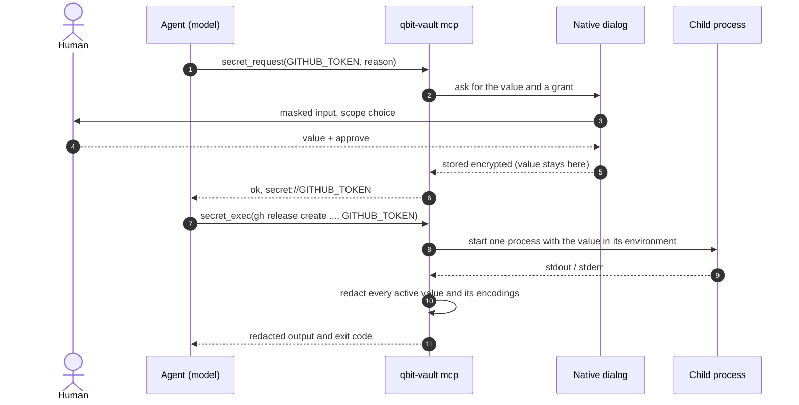
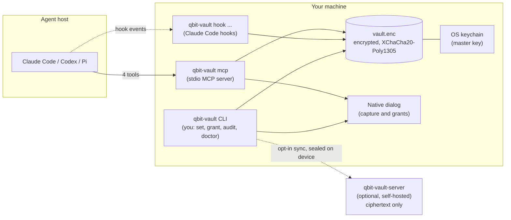

<p align="center">
  
</p>

# QBit Vault

[](https://github.com/QuBiit0/qbit-vault/actions/workflows/ci.yml)
[](LICENSE)
[](go.mod)
[](#status--roadmap)

**Agents use your secrets. They never see them.**  
by **qbitdev**

QBit Vault (`qbit-vault`) is a local secrets broker for coding agents. Claude Code, Codex and Pi / Gentle Shell can run commands that need a `GITHUB_TOKEN`, a `DATABASE_URL` or any API key, and the value never enters the model's context, the chat transcript, the session file or the provider's servers.

> **Status: public beta (`v0.1.0-beta.2`).** The vault, the broker, the MCP server, host registration and multi-device sync are built and tested on Linux, macOS and Windows. Expect rough edges and report them in [Issues](https://github.com/QuBiit0/qbit-vault/issues). See [Status / Roadmap](#status--roadmap).

## Why

The usual ways to give an agent a credential all leak it: the value sits in the shell environment where `env` can read it, or you paste it into the chat and it lands in the transcript. QBit Vault gives the agent a third way: it asks for a **name**, you provide the **value** out of band, and the runtime uses the value for one command without handing it back.

| The agent | You | QBit Vault |
| --- | --- | --- |
| Asks for `GITHUB_TOKEN` with a reason | Type the value in a native dialog, never in the chat | Stores it encrypted, key in the OS keychain |
| Runs a command that needs it | Pick the grant (once, session or project) | Injects it into one child process and redacts the output |
| Sees names and redacted results | | Never returns the value |

## How it works



The model sees tool names, secret **names** and redacted results. The value exists only in the dialog, the encrypted vault and the environment of that one child process.

## Architecture



Details: [docs/ARCHITECTURE.md](docs/ARCHITECTURE.md), [docs/STORAGE.md](docs/STORAGE.md).

## Quickstart

Install with one command (it verifies the SHA-256 of the release archive; details and options in [docs/INSTALL.md](docs/INSTALL.md)):

```bash
# Linux / macOS
curl -fsSL https://raw.githubusercontent.com/QuBiit0/qbit-vault/main/scripts/install.sh | sh
```

```powershell
# Windows (PowerShell)
irm https://raw.githubusercontent.com/QuBiit0/qbit-vault/main/scripts/install.ps1 | iex
```

Or, with Go 1.26+: `go install github.com/QuBiit0/qbit-vault/cmd/qbit-vault@latest`.

```bash
# 1. Check the install
qbit-vault version

# 2. Create an empty vault and register the agents it finds on this machine
qbit-vault init

# 3. Store a secret yourself (masked prompt; --global or --project)
qbit-vault set GITHUB_TOKEN --global

# 4. Check what was configured
qbit-vault doctor

# Or do all of it interactively (needs a terminal; same as `qbit-vault tui`)
qbit-vault
```

- `init` asks for nothing and never reads secrets from your environment. It creates an **empty** vault, stores the master key in the OS keychain (on a machine without one, run `init --passphrase`) and registers the hosts it detects. Every config file is snapshotted before it is touched.
- Choose hosts explicitly with `qbit-vault init --agents claude-code,codex,pi` (or `--agents none`). Re-run `qbit-vault sync` to re-apply the registrations after an upgrade.
- Restart your agent afterwards so it picks up the MCP server.
- To undo: `qbit-vault uninstall` reverts each host's config from its snapshot; `--purge` also deletes the vault.

Secrets are **global** (usable everywhere) or belong to **one project**; a project secret overrides a global one with the same name. Both live in the same encrypted vault under `~/.qbit-vault/`, never in the repository.

Build from a checkout instead:

```bash
git clone https://github.com/QuBiit0/qbit-vault && cd qbit-vault
go build -o qbit-vault ./cmd/qbit-vault
```

## What the agent sees

| Tool | What the model gets back |
| --- | --- |
| `secret_request(name, reason)` | `ok` and a `secret://NAME` reference, after you typed the value in the dialog. Never the value. |
| `secret_list()` | Names, layers, descriptions, scopes and the rules the agent must follow. Never values. |
| `secret_exec(command, secrets)` | Redacted stdout and stderr plus the exit code. |
| `secret_manage(action, name, ...)` | Proposes remove, edit, move or replace. You confirm outside the chat; the agent gets `ok`. |

There is no `grant` tool: only you grant access, in the dialog. Contract: [contracts/secrets-broker/v1/CONTRACT.md](contracts/secrets-broker/v1/CONTRACT.md).

## Commands

Full reference with flags, JSON output and exit codes: [docs/CLI.md](docs/CLI.md). Most commands take `--json`.

| Group | Commands |
| --- | --- |
| Setup | `init`, `sync`, `doctor`, `uninstall`, `version`, `tui` (also what bare `qbit-vault` runs in a terminal) |
| Secrets | `set`, `rm`, `mv`, `list`, `describe`, `edit`, `link`, `relink`, `import`, `rekey`, `lock`, `unlock`, `restore` |
| Grants | `grant`, `revoke`, `grants` |
| Run | `exec` (run a command with granted secrets injected and the output redacted) |
| Audit | `audit` (`--tail`, `--since`, `--name`, `--event`), `audit --verify` |
| Remote sync | `remote register`, `join`, `approve`, `sync`, `status`, `devices`, `revoke-device`, `recovery-key --rotate`, `conflicts`, `resolve`, `history`, `restore`, `logout` |
| Host plumbing (not for humans) | `mcp`, `hook pre-bash\|post-bash\|post-read\|user-prompt`, `prompt`, `broker --op` |

## Security model

These are the invariants the code is tested against ([AGENTS.md](AGENTS.md)); the full analysis is in [docs/THREAT_MODEL.md](docs/THREAT_MODEL.md).

1. **The model never gets a value.** No tool result, MCP response, hook output, log line, error or panic carries a secret value. Errors name the secret only.
2. **Nothing sensitive touches disk in the clear.** Not temp files, not shell history, not the audit log.
3. **Install never asks for a secret.** `init` creates an empty vault and does not read your environment.
4. **Injection is per child process.** The value goes into one command's environment, not the agent's, not your shell's.
5. **Output is redacted.** Raw values and their common encodings are removed from stdout, stderr and file content read while a grant is active.
6. **You approve every capture and every grant.** No auto-approval; "remember" only if you choose it in the dialog.
7. **Config edits are reversible.** Every change to a host config is snapshotted first and written atomically.
8. **No surprise network.** No postinstall scripts, no network calls except the sync server you configured. Nothing that decrypts the vault ever leaves your device.
9. **The sync server is untrusted.** Everything downloaded from it is verified before use, and recovery keys and pairing codes are shown only through the dialog, never on stdout or in logs.

Also in place: tamper-evident audit log (`audit --verify`), grants bound to one record with a scope and a TTL, a guard that refuses `env`/`printenv`-style dump commands while secrets are injected, and per-secret allowlists of binaries and hosts.

## Supported hosts

`init` registers each host it detects. Every host gets the MCP server and the `qbit-vault` agent skill, which tells the agent when to reach for the tools (any command that needs a credential) and how; only Claude Code gets hooks and deny rules. The skill is kept current by `sync`, which the install scripts run after every upgrade.

| Host | MCP tools | Skill | Hooks | Deny rules | Notes |
| --- | --- | --- | --- | --- | --- |
| Claude Code | yes | `~/.claude/skills` | `pre-bash`, `post-bash`, `post-read`, `user-prompt` | `Read` / `Edit` of the vault directory | `post-*` redact tool output; `user-prompt` blocks a prompt that carries a secret; `pre-bash` keeps user-only commands out of the agent's shell |
| Codex | yes | `~/.agents/skills` | no | no | `secret_exec` output is already redacted |
| Pi / Gentle Shell | yes | `~/.agents/skills` (shared with Codex) | no | no | via `mcp.json`; the native extension is planned |

OpenCode is not supported. Per-host files and the hook protocol: [docs/AGENT_INTEGRATIONS.md](docs/AGENT_INTEGRATIONS.md).

## Remote sync (optional)

Keep one vault on several machines with `qbit-vault-server`, a small service you host yourself.

- **Zero-knowledge.** The server stores ciphertext, public keys and counters. It has nothing that decrypts them, and the client verifies every object it downloads.
- **Opt-in.** A vault that never runs `qbit-vault remote register` makes no network call.
- **Recovery key.** Shown once at registration; keep it offline. Devices join by pairing codes confirmed on both machines, and a lost device can be revoked (which rotates the keys).
- **Grants and the audit log stay local.** Secrets, metadata and the device roster sync, encrypted.
- **Deploy.** `deploy/Dockerfile` and `deploy/compose.yaml` build the server image from this repository (no image is published yet), for example behind Dokploy:

```bash
docker compose -f deploy/compose.yaml up -d --build
docker compose -f deploy/compose.yaml exec server /qbit-vault-server invite --ttl 24h
qbit-vault remote register --server https://vault.example.com
```

Protocol, keys and failure modes: [docs/REMOTE_SYNC.md](docs/REMOTE_SYNC.md).

## Status / Roadmap

**Built and tested** (on `main`, see [docs/ROADMAP.md](docs/ROADMAP.md)): encrypted vault with global and project layers, grants, hash-chained audit log, redaction, `exec`, native prompts (Windows, macOS, Linux, terminal), the contract broker and MCP server, host registration for Claude Code, Codex and Pi, remote sync with `qbit-vault-server`, and the interactive TUI (`qbit-vault`, see [docs/CLI.md](docs/CLI.md#tui)): first-run setup, then three panes for secrets, grants, hosts, audit, sync status and doctor. Not exercised yet: the TUI's suspend and resume (for the masked value prompt) on a real terminal; its tests replace that step.

**Planned, not built yet** — do not rely on these:

| Item | Phase |
| --- | --- |
| Pi / Gentle Shell extension (`qbit-vault-pi`): inline capture, shell-tool override, redaction hook | 4 |
| Claude Code `PreToolUse` rewrite of secret references into `exec`, and its `grant_required` / `dump_command` denials | 4 |
| Minisign-signed checksums, npm launcher, Homebrew formula, published server image (release archives, `checksums.txt`, build provenance and the install scripts exist) | 5 |
| `qbit-vault update` and the opt-out update check | 5 |
| `qbit-vault redact` command (the redaction engine exists and is used by `exec`, hooks and the MCP server) | 4 (the Pi extension design calls it; no `redact` command exists) |
| TUI self-update (the Update section is a static *planned* screen that shows the manual `go install` command) | 5, with `qbit-vault update` |

Known gaps that the docs state openly: no automatic passphrase fallback when there is no keychain (use `init --passphrase`), `bindings.yaml` and `config.yaml` are not loaded yet (budgets and TTLs are constants), and Codex and Pi get no hooks or deny rules.

## Documentation

| Document | What it is |
| --- | --- |
| [docs/PRD.md](docs/PRD.md) | Requirements with stable IDs, scope, non-goals, implementation status |
| [docs/THREAT_MODEL.md](docs/THREAT_MODEL.md) | Assets, attackers, leak paths, controls, residual risk |
| [docs/ARCHITECTURE.md](docs/ARCHITECTURE.md) | Components, data flows, process model, decisions |
| [docs/STORAGE.md](docs/STORAGE.md) | Vault file format, crypto, keychain, grants, audit log |
| [docs/CLI.md](docs/CLI.md) | Every command, flag and exit code |
| [docs/INSTALL.md](docs/INSTALL.md) | Install today, what `init` does step by step, uninstall |
| [docs/AGENT_INTEGRATIONS.md](docs/AGENT_INTEGRATIONS.md) | MCP server, hooks and capture path per host |
| [docs/GENTLE_SHELL_EXTENSION.md](docs/GENTLE_SHELL_EXTENSION.md) | The planned Pi / Gentle Shell extension |
| [docs/REMOTE_SYNC.md](docs/REMOTE_SYNC.md) | Multi-device sync protocol and server |
| [docs/TESTING.md](docs/TESTING.md) | Test tiers, leak battery, cross-agent battery |
| [docs/ROADMAP.md](docs/ROADMAP.md) | Phased delivery |
| [docs/PROPOSAL.md](docs/PROPOSAL.md) | The original proposal (historical) |
| [contracts/secrets-broker/v1/CONTRACT.md](contracts/secrets-broker/v1/CONTRACT.md) | The wire contract and typed refusals |
| [design/system.md](design/system.md) | Visual identity and design tokens |
| [AGENTS.md](AGENTS.md) | Instructions for the coding agent building this repo |
| [odd/README.md](odd/README.md) | What `odd/tasks/` is: the development logs, not user documentation |

## Contributing

Contributions are welcome once the repository is public; the rules are in [CONTRIBUTING.md](CONTRIBUTING.md). Read [AGENTS.md](AGENTS.md) first: the security invariants there are tested, and a change that breaks one is rejected.

## Security

Do not report a vulnerability in a public issue. Follow [SECURITY.md](SECURITY.md). The threat model and what is out of scope are in [docs/THREAT_MODEL.md](docs/THREAT_MODEL.md).

## License

Released under the [MIT license](LICENSE).

## Community

QBit Vault is built and maintained by **qbitdev**. The repository is not public yet; the public launch will bring a place to ask questions and report issues.

## Independence

QBit Vault is a personal tool by **qbitdev**. It is not part of Gentle AI and is not affiliated with or endorsed by the authors of Claude Code, Codex, Pi, Gentle AI or Gentle Shell; those names belong to their respective owners. It integrates with them through their public extension points.
