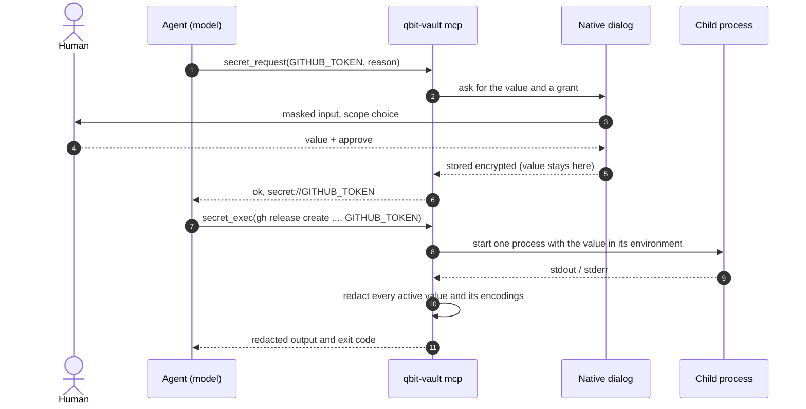
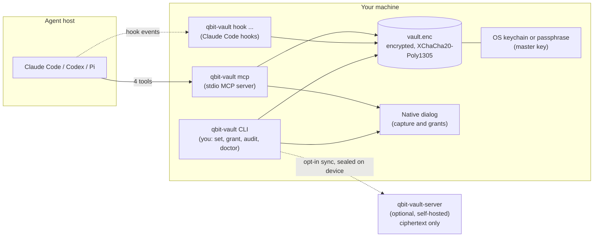

<p align="center">
  
</p>

# QBit Vault

[](https://github.com/qbitdevz/qbit-vault/releases)
[](https://github.com/qbitdevz/qbit-vault/actions/workflows/ci.yml)
[](LICENSE)
[](go.mod)

**Agents use your secrets. They never see them.**  
by **qbitdev**

QBit Vault (`qbit-vault`) is a local secrets broker for coding agents. Claude Code, Codex and Pi / Gentle Shell can run commands that need a `GITHUB_TOKEN`, a `DATABASE_URL` or any API key, and the value never enters the model's context, the chat transcript, the session file or the provider's servers.

> **Public beta.** Built and tested on Linux, macOS and Windows; expect rough edges. Found one? [Open an issue](https://github.com/qbitdevz/qbit-vault/issues) with the output of `qbit-vault doctor` (it never contains a secret value).

## Get started

### 1. Install

```bash
# Linux, macOS, WSL
curl -fsSL https://github.com/qbitdevz/qbit-vault/releases/latest/download/install.sh | sh
```

```powershell
# Windows (PowerShell)
irm https://github.com/qbitdevz/qbit-vault/releases/latest/download/install.ps1 | iex
```

The scripts are assets of every release (`releases/latest/download/…`); the copies in `scripts/` are the same files. The script downloads the latest release for your system, checks its SHA-256 and installs `qbit-vault` (Linux and macOS: `~/.local/bin`; Windows: added to your `PATH`, open a new terminal). Running it again upgrades in place. With Go 1.26+ you can use `go install github.com/qbitdevz/qbit-vault/cmd/qbit-vault@latest` instead. Options and details: [docs/INSTALL.md](docs/INSTALL.md).

### First 5 minutes

1. **Install** with the command above.
2. **Run `qbit-vault init`** (or just `qbit-vault`). It creates an empty vault and connects your agents.
3. **Restart your agent** so it loads QBit Vault.
4. **Ask for something that needs a credential** (*"create a GitHub release for v1.2"*). A window like this opens, outside the chat; approve it:


Pick **Once** (the default) and it asks again next time; pick **Always: in this project** and it stops asking in that repository until you revoke it (`qbit-vault revoke`). The agent never sees the value either way.

### 2. Set it up

```bash
qbit-vault
```

A guided setup: where the master key is kept, and which agents to connect. (`qbit-vault init` does the same without questions.)

- It creates an **empty** vault in `~/.qbit-vault/`. It never reads your `.env` files or environment variables.
- It connects the agents it finds (Claude Code, Codex, Pi): the MCP server plus the `qbit-vault` skill, which tells the agent to use the vault whenever a command needs a credential. Every config file is backed up before it is touched.
- The master key goes into your OS keychain. Where there is none (WSL, a Linux server) it asks for a passphrase instead; `qbit-vault unlock` opens the vault later.

**Then restart your agent** so it loads QBit Vault.

### 3. Store your secrets

```bash
qbit-vault set GITHUB_TOKEN --global       # usable in every folder
cd my-project
qbit-vault set DATABASE_URL --project      # only for this repository
```

You type the value in a hidden prompt: it is not echoed and not kept in your shell history. You can also skip this step and let the agent ask for what it needs.

### 4. Use it from your agent

Ask for something ordinary: *"create a GitHub release for v1.2"*, *"run the migrations against the database"*.

1. The agent sees it needs a credential and asks QBit Vault for it **by name**.
2. A **native dialog** (outside the chat) asks you to approve it: once, or always in this project (inside a git repository). A secret that does not exist yet is typed right there.
3. The command runs with the value injected into **that one process**, and the output comes back **redacted**: wherever the value appears, the agent sees `[REDACTED:GITHUB_TOKEN]`.

The agent never sees the value: not in the chat, not in the transcript, not on the provider's servers.

## Everyday commands

| You want to | Command |
| --- | --- |
| See which secrets exist (names only, never values) | `qbit-vault list` |
| See what was used and who approved it | `qbit-vault audit` |
| Check that everything is set up | `qbit-vault doctor` |
| Take back every permission you gave | `qbit-vault revoke --all` |
| Move a secret between global and this project | `qbit-vault mv NAME --to global` (or `--to project`) |
| Open a passphrase-protected vault | `qbit-vault unlock` |
| Upgrade | run the install command again |
| Uninstall | `qbit-vault uninstall` (keeps the vault) or `qbit-vault uninstall --purge` (deletes it) |

Every command, flag and exit code: [docs/CLI.md](docs/CLI.md). Most commands take `--json`.

## Global and project secrets

Each secret lives in one of two **layers**:

- **Global**: available in every folder. For what you use everywhere, such as a personal `GITHUB_TOKEN` or an API key.
- **Project**: tied to one git repository. For what belongs to that project, such as its `DATABASE_URL` or a client's deploy token.

When the agent asks for a name inside a repository, the project's secret wins; if the project has none, the global one is used. So one name can have a different value per project. From repository A the agent can never see or use the secrets of repository B, and the permissions you approve are tied to the layer too.

Inside a repository, `qbit-vault set NAME` with neither flag asks which layer you want. `qbit-vault list` shows what this folder sees and which project secret overrides a global one; `qbit-vault list --layer all` shows everything. Both layers live in the same encrypted vault under `~/.qbit-vault/`, never in the repository.

## Why

The usual ways to give an agent a credential all leak it: the value sits in the shell environment where `env` can read it, or you paste it into the chat and it lands in the transcript. QBit Vault gives the agent a third way: it asks for a **name**, you provide the **value** out of band, and the runtime uses the value for one command without handing it back.

| The agent | You | QBit Vault |
| --- | --- | --- |
| Asks for `GITHUB_TOKEN` with a reason | Type the value in a native dialog, never in the chat | Stores it encrypted, key in the OS keychain |
| Runs a command that needs it | Pick the grant (once, or always in this project) | Injects it into one child process and redacts the output |
| Sees names and redacted results | | Never returns the value |

## How it works



The model sees tool names, secret **names** and redacted results. The value exists only in the dialog, the encrypted vault and the environment of that one child process.

### What the agent sees

| Tool | What the model gets back |
| --- | --- |
| `secret_list()` | Names, layers, descriptions, scopes and the rules the agent must follow. Never values. |
| `secret_request(name, reason)` | `ok` and a `secret://NAME` reference, after you approved or typed the value in the dialog. Never the value. |
| `secret_exec(command, secrets)` | Redacted stdout and stderr plus the exit code. |
| `secret_manage(action, name, ...)` | Proposes remove, edit, move or replace. You confirm outside the chat; the agent gets `ok`. |

There is no `grant` tool: only you grant access, in the dialog. Contract: [contracts/secrets-broker/v1/CONTRACT.md](contracts/secrets-broker/v1/CONTRACT.md).

### Architecture



Details: [docs/ARCHITECTURE.md](docs/ARCHITECTURE.md), [docs/STORAGE.md](docs/STORAGE.md).

## Supported agents

Every agent gets the MCP server and the `qbit-vault` skill; only Claude Code also gets hooks and deny rules. The skill is kept current by `qbit-vault sync`, which the install scripts run after every upgrade.

| Agent | MCP tools | Skill | Hooks | Deny rules | Notes |
| --- | --- | --- | --- | --- | --- |
| Claude Code | yes | `~/.claude/skills` | `pre-bash`, `post-bash`, `post-read`, `user-prompt` | `Read` / `Edit` of the vault directory | `post-*` redact tool output; `user-prompt` blocks a prompt that carries a secret; `pre-bash` keeps user-only commands out of the agent's shell |
| Codex | yes | `~/.agents/skills` | no | no | `secret_exec` output is already redacted |
| Pi / Gentle Shell | yes | `~/.agents/skills` (shared with Codex) | no | no | via `mcp.json`; a native extension is planned |

Choose agents yourself with `qbit-vault init --agents claude-code,codex,pi` (or `--agents none`). OpenCode is not supported. Per-agent files and the hook protocol: [docs/AGENT_INTEGRATIONS.md](docs/AGENT_INTEGRATIONS.md).

## Security model

These are the invariants the code is tested against ([AGENTS.md](AGENTS.md)); the full analysis is in [docs/THREAT_MODEL.md](docs/THREAT_MODEL.md).

1. **The model never gets a value.** No tool result, MCP response, hook output, log line, error or panic carries a secret value. Errors name the secret only.
2. **Nothing sensitive touches disk in the clear.** Not temp files, not shell history, not the audit log.
3. **Setup never asks for a secret.** `init` creates an empty vault and does not read your environment.
4. **Injection is per child process.** The value goes into one command's environment, not the agent's, not your shell's.
5. **Output is redacted.** Raw values and their common encodings are removed from stdout, stderr and file content read while a grant is active.
6. **You approve every capture and every grant.** No auto-approval; "remember" only if you choose it in the dialog.
7. **Config edits are reversible.** Every change to an agent's config is backed up first and written atomically.
8. **No surprise network.** No postinstall scripts, no network calls except the release download during install and the sync server you configured. Nothing that decrypts the vault ever leaves your device.
9. **The sync server is untrusted.** Everything downloaded from it is verified before use, and recovery keys and pairing codes are shown only through the dialog, never on stdout or in logs.

Also in place: tamper-evident audit log (`audit --verify`), grants bound to one record with a scope and a TTL, a guard that refuses `env`/`printenv`-style dump commands while secrets are injected, and per-secret allowlists of binaries and hosts.

## Backup

A broken machine should not cost you the vault. `qbit-vault export FILE` writes one encrypted, portable copy (it asks for an export passphrase of at least 12 characters), and on a new machine `qbit-vault init` then `qbit-vault import --from-export FILE` brings every secret back with its metadata. It needs no server and no account; keep the file and its passphrase in different places, because together they are a full copy. See [docs/INSTALL.md](docs/INSTALL.md#backup-without-a-server).

## Several machines (optional)

**Sync is optional: using QBit Vault on one machine needs no account and no server.**

Keep one vault on several machines with `qbit-vault-server`, a small service you host yourself.

> **Two commands share the word "sync".** `qbit-vault sync` re-applies your coding-agent registrations (after an upgrade or when an agent rewrote its config). `qbit-vault remote sync` syncs your secrets between devices. When your vault syncs with a server, `qbit-vault sync` reminds you of the second one.

- **Zero-knowledge.** The server stores ciphertext, public keys and counters. It has nothing that decrypts them, and the client verifies every object it downloads.
- **Opt-in.** A vault that never runs `qbit-vault remote register` makes no network call.
- **Recovery key.** Shown once at registration; keep it offline. Devices join by pairing codes confirmed on both machines, and a lost device can be revoked (which rotates the keys).
- **Grants and the audit log stay local.** Secrets, metadata and the device roster sync, encrypted. On another machine, `qbit-vault link <label>` ties a synced project to its folder there.
- **Deploy.** `deploy/Dockerfile` and `deploy/compose.yaml` build the server image from this repository (no image is published yet), for example behind Dokploy:

```bash
docker compose -f deploy/compose.yaml up -d --build
docker compose -f deploy/compose.yaml exec server /qbit-vault-server invite --ttl 24h
qbit-vault remote register --server https://vault.example.com
```

Step by step: [docs/INSTALL.md](docs/INSTALL.md#several-machines-optional). Protocol, keys and failure modes: [docs/REMOTE_SYNC.md](docs/REMOTE_SYNC.md).

## All commands

| Group | Commands |
| --- | --- |
| Setup | `init`, `sync`, `doctor`, `uninstall`, `version`, `tui` (also what bare `qbit-vault` runs in a terminal) |
| Secrets | `set`, `rm`, `mv`, `list`, `describe`, `edit`, `link`, `relink`, `import`, `export`, `rekey`, `lock`, `unlock`, `restore` |
| Grants | `grant`, `revoke`, `grants` |
| Run | `exec` (run a command with granted secrets injected and the output redacted) |
| Audit | `audit` (`--tail`, `--since`, `--name`, `--event`), `audit --verify` |
| Remote sync | `remote register`, `join`, `approve`, `sync`, `status`, `devices`, `revoke-device`, `recovery-key --rotate`, `conflicts`, `resolve`, `history`, `restore`, `logout` |
| Agent plumbing (not for humans) | `mcp`, `hook pre-bash\|post-bash\|post-read\|user-prompt`, `prompt`, `broker --op` |

Reference: [docs/CLI.md](docs/CLI.md).

## Status and roadmap

**Built and tested** ([docs/ROADMAP.md](docs/ROADMAP.md)): encrypted vault with global and project layers, grants, hash-chained audit log, redaction, `exec`, native prompts (Windows, macOS, Linux, terminal), the contract broker and MCP server, the agent skill, registration for Claude Code, Codex and Pi, one-line install and in-place upgrade, remote sync with `qbit-vault-server`, the offline backup (`export` / `import --from-export`), and the interactive TUI ([docs/CLI.md](docs/CLI.md#tui)).

**Planned, not built yet**, do not rely on these:

| Item | Phase |
| --- | --- |
| Pi / Gentle Shell extension (`qbit-vault-pi`): inline capture, shell-tool override, redaction hook | 4 |
| Claude Code `PreToolUse` rewrite of secret references into `exec` | 4 |
| `qbit-vault redact` command (the redaction engine exists and is used by `exec`, hooks and the MCP server) | 4 |
| `qbit-vault update`, an opt-out update check and TUI self-update (today: run the install command again) | 5 |
| Minisign-signed checksums, npm launcher, Homebrew formula, published server image | 5 |

Known gaps the docs state openly: `bindings.yaml` and `config.yaml` are not loaded yet (budgets and TTLs are constants), and Codex and Pi get no hooks or deny rules.

## Documentation

| Document | What it is |
| --- | --- |
| [docs/INSTALL.md](docs/INSTALL.md) | Install, upgrade, what `init` does step by step, several machines, uninstall |
| [docs/CLI.md](docs/CLI.md) | Every command, flag and exit code |
| [docs/AGENT_INTEGRATIONS.md](docs/AGENT_INTEGRATIONS.md) | MCP server, skill, hooks and capture path per agent |
| [docs/THREAT_MODEL.md](docs/THREAT_MODEL.md) | Assets, attackers, leak paths, controls, residual risk |
| [docs/ARCHITECTURE.md](docs/ARCHITECTURE.md) | Components, data flows, process model, decisions |
| [docs/STORAGE.md](docs/STORAGE.md) | Vault file format, crypto, keychain, grants, audit log |
| [docs/REMOTE_SYNC.md](docs/REMOTE_SYNC.md) | Multi-device sync protocol and server |
| [docs/PRD.md](docs/PRD.md) | Requirements with stable IDs, scope, non-goals, implementation status |
| [docs/TESTING.md](docs/TESTING.md) | Test tiers, leak battery, Docker batteries |
| [docs/ROADMAP.md](docs/ROADMAP.md) | Phased delivery |
| [docs/GENTLE_SHELL_EXTENSION.md](docs/GENTLE_SHELL_EXTENSION.md) | The planned Pi / Gentle Shell extension |
| [docs/PROPOSAL.md](docs/PROPOSAL.md) | The original proposal (historical) |
| [contracts/secrets-broker/v1/CONTRACT.md](contracts/secrets-broker/v1/CONTRACT.md) | The wire contract and typed refusals |
| [CHANGELOG.md](CHANGELOG.md) | What changed in each release |
| [design/system.md](design/system.md) | Visual identity and design tokens |
| [AGENTS.md](AGENTS.md) | Instructions for the coding agent building this repo |
| [odd/README.md](odd/README.md) | What `odd/tasks/` is: the development logs, not user documentation |

## Contributing

Contributions are welcome; the rules are in [CONTRIBUTING.md](CONTRIBUTING.md). Read [AGENTS.md](AGENTS.md) first: the security invariants there are tested, and a change that breaks one is rejected. Bug reports and feature requests go to [Issues](https://github.com/qbitdevz/qbit-vault/issues) (guided forms); questions and ideas to [Discussions](https://github.com/qbitdevz/qbit-vault/discussions). How contributions are reviewed: [CONTRIBUTING.md § How contributions are reviewed](CONTRIBUTING.md#how-contributions-are-reviewed).

## Security

Do not report a vulnerability in a public issue: use [private vulnerability reporting](https://github.com/qbitdevz/qbit-vault/security/advisories/new), as described in [SECURITY.md](SECURITY.md). The threat model and what is out of scope are in [docs/THREAT_MODEL.md](docs/THREAT_MODEL.md).

## License

Released under the [MIT license](LICENSE).

## Independence

QBit Vault is a personal tool by **qbitdev**. It is not part of Gentle AI and is not affiliated with or endorsed by the authors of Claude Code, Codex, Pi, Gentle AI or Gentle Shell; those names belong to their respective owners. It integrates with them through their public extension points.
